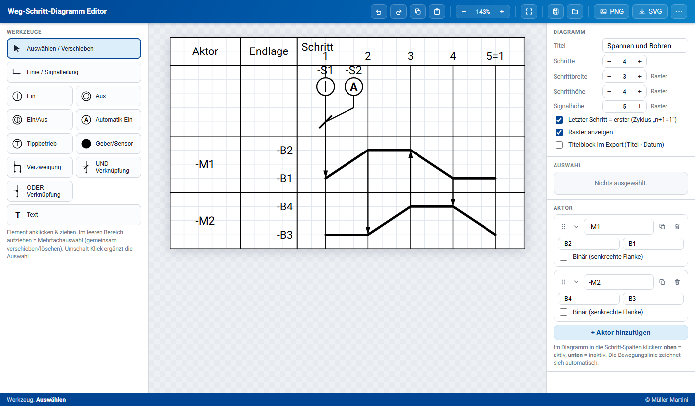
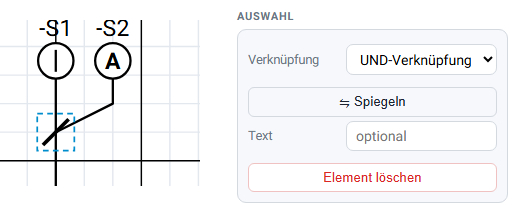
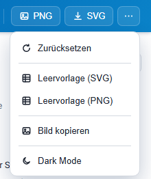

# Weg-Schritt-Diagramm Editor

Ein eigenständiger Editor zum Zeichnen von **Funktionsdiagrammen / Weg-Schritt-Diagrammen**
(Aktorbewegung über Schritte + Signal-/Steuerteil) mit **SVG- und PNG-Export**.

## Starten
Datei **`wegschritt-editor.html`** per Doppelklick im Browser öffnen
(Chrome, Edge, Firefox). Keine Installation, kein Internet nötig – läuft komplett offline.
Die Arbeit wird automatisch im Browser zwischengespeichert und beim nächsten Öffnen
wiederhergestellt.

## Aufbau des Fensters
- **Links:** Werkzeugleiste (Auswählen, Linie, Signalglieder, Verknüpfungen, Text).
- **Mitte:** Zeichenfläche mit Raster.
- **Rechts:** Einstellungen zum *Diagramm*, das Panel *Auswahl* (Eigenschaften des
  gerade gewählten Elements) und die Liste der *Aktoren*.
- **Oben:** Rückgängig/Wiederholen, Kopieren/Einfügen, Zoom, Ansicht anpassen,
  Projekt speichern/laden, PNG-/SVG-Export und das Menü **⋯** (weitere Aktionen).
- **Unten:** Statusleiste mit dem aktiven Werkzeug.

## Bedienung

### Weg-Schritt-Teil (unten)
- **Aktoren** in der Seitenleiste rechts anlegen/benennen: Name sowie Bezeichnung der
  oberen (ausgefahren/aktiv) und unteren (eingefahren/inaktiv) Endlage.
  - **+ Aktor hinzufügen** legt eine weitere Zeile an.
  - Über die Symbole im Kopf einer Aktor-Karte lässt sich ein Aktor **duplizieren**
    oder **entfernen** (mindestens einer bleibt erhalten).
  - Am **Griff** (⋮⋮) ziehen, um die Reihenfolge zu ändern; mit dem Pfeil lässt sich
    eine Karte ein-/ausklappen.
- **Binär (senkrechte Flanke):** Pro Aktor wählbar. Damit schaltet die Bewegungslinie
  senkrecht (z. B. Magnetventil, Lampe, Signal) statt schräg über einen Schritt.
- **Schritte** über die Stepper-Schaltfläche festlegen. Bei aktivem Zyklus wird die letzte
  Linie als „n+1 = 1“ beschriftet und automatisch gleich dem ersten Schritt gesetzt.
- **Position setzen:** Mit dem Werkzeug *Auswählen* in eine Schritt-Spalte klicken –
  **oben** = aktiv/ausgefahren, **unten** = inaktiv/eingefahren. Die Bewegungslinie
  zeichnet sich automatisch.
- **Beschriften direkt im Diagramm:** Aktorname oder Endlagen-Bezeichnung doppelklicken
  und überschreiben (oder die Felder in der Seitenleiste nutzen).

### Signal-/Steuerteil (oben)
- In der Werkzeugleiste ein **Signalglied** (Ein, Aus, Ein/Aus, Automatik Ein,
  Tippbetrieb, Geber/Sensor) oder eine **Verknüpfung** (Verzweigung, UND, ODER) wählen
  und ins Diagramm klicken. Beim Platzieren eines Signalglieds wird gleich nach der
  Beschriftung gefragt. Verknüpfungen rasten an vorhandenen Linienpunkten ein.
- **Text:** Mit dem Werkzeug *Text* freie Beschriftungen platzieren.
- **Linie / Signalleitung:** Werkzeug *Linie* wählen, nacheinander Eckpunkte klicken,
  **Doppelklick** oder **Enter** beendet die Linie, **Esc** bricht ab. Punkte rasten
  automatisch an vorhandenen Linienpunkten und Anschlüssen ein (gefüllter Punkt =
  fängt ein), damit Leitungen exakt zusammentreffen.

### Auswählen, Verschieben, Bearbeiten
- **Verschieben:** Mit *Auswählen* anklicken und ziehen; bei Linien lassen sich die
  blauen Eckpunkte einzeln ziehen. Mit den **Pfeiltasten** lässt sich die Auswahl fein
  verschieben (**Umschalt** = grössere Schritte).
- **Mehrfachauswahl:** In einem leeren Bereich einen Rahmen aufziehen, oder mit
  **Umschalt/Strg + Klick** Elemente einzeln zur Auswahl hinzufügen. Eine Gruppe lässt
  sich gemeinsam verschieben und löschen.
- **Beschriften:** Element doppelklicken und direkt im Diagramm bearbeiten, oder im
  Panel *Auswahl* den Text/das Symbol eintragen.
- **Eigenschaften (Panel *Auswahl*):**
  - *Signalglied:* Symbol wechseln, Beschriftung, **weißer Hintergrund**, **Negiert
    (Überstrich)**.
  - *Text:* Inhalt, **Rahmen**, **weißer Hintergrund**, **Negiert (Überstrich)**.
  - *Verknüpfung:* Typ wechseln, optionaler Text; bei UND zusätzlich **⇋ Spiegeln**
    (Schrägstrich „/“ ↔ „\“, z. B. wenn er auf einer diagonalen Leitung liegt).
  - *Linie:* **Pfeilspitze am Ende** ein/aus, **Richtung umkehren**.

  
- **Löschen:** Element/Linie auswählen und **Entf** drücken.
- **Esc:** bricht eine angefangene Linie ab bzw. hebt die Auswahl auf und wechselt zum
  Werkzeug *Auswählen*.

### Tastenkürzel
| Kürzel | Funktion |
|---|---|
| <kbd>Strg</kbd>+<kbd>Z</kbd> | Rückgängig |
| <kbd>Strg</kbd>+<kbd>Y</kbd> / <kbd>Strg</kbd>+<kbd>Umschalt</kbd>+<kbd>Z</kbd> | Wiederholen |
| <kbd>Strg</kbd>+<kbd>C</kbd> / <kbd>Strg</kbd>+<kbd>X</kbd> / <kbd>Strg</kbd>+<kbd>V</kbd> | Kopieren / Ausschneiden / Einfügen (leicht versetzt) |
| <kbd>Entf</kbd> | Auswahl löschen |
| Pfeiltasten (+ <kbd>Umschalt</kbd>) | Auswahl verschieben |
| <kbd>Enter</kbd> / <kbd>Esc</kbd> | Linie beenden / abbrechen |

### Diagramm-Einstellungen (rechte Seitenleiste)
- **Titel** des Diagramms.
- **Schritte** – Anzahl der Schritt-Spalten.
- **Schrittbreite / Schritthöhe / Signalhöhe** – in Rastereinheiten anpassbar.
- **Letzter Schritt = erster (Zyklus „n+1=1“)** – schliesst den Bewegungsablauf zum Zyklus.
- **Raster anzeigen** – Hintergrundraster ein-/ausblenden.
- **Titelblock im Export (Titel · Datum)** – fügt Titel und Datum in den Export ein
  (ohne diese Option wird der Titel nicht exportiert).

### Ansicht
- **+ / −** und **Ansicht anpassen** zum Zoomen; daneben wird die aktuelle Zoomstufe
  in Prozent angezeigt.
- **⋯ → Dark Mode** schaltet zwischen hellem und dunklem Erscheinungsbild um.
- **⋯ → Zurücksetzen** löscht das gesamte Diagramm und beginnt mit einem leeren Gerüst
  (mit Sicherheitsabfrage).

### Export & Speichern

- **SVG** – maßstabsfreie Vektordatei (ideal für Dokumente/Druck).
- **PNG** – Pixelbild (2-fache Auflösung).
- **⋯ → Bild kopieren** – legt das Diagramm als Bild in die Zwischenablage, direkt
  einfügbar in Word, PowerPoint oder E-Mails.
- **⋯ → Leervorlage (SVG / PNG)** – leeres Tabellengerüst (Rahmen, Spalten,
  Schrittlinien, Aktorzeilen) ohne Beschriftungen und Bewegungslinien, zum Ausfüllen
  von Hand.
- **Projekt speichern / laden** – als `.json`, um später weiterzuarbeiten.

## Hinweis zur Norm
Die Darstellung folgt der klassischen **Weg-Schritt-Diagramm-Optik** (angelehnt an VDI 3260).
Das ist bewusst **nicht** GRAFCET (DIN EN 60848), das eine völlig andere Darstellung mit
Schritt-Kästchen und Transitionen verwendet.

## Lizenz
© Müller Martini – veröffentlicht unter der [MIT-Lizenz](LICENSE).

In `wegschritt-editor.html` sind folgende Fremdkomponenten eingebettet:
- [opentype.js](https://github.com/opentypejs/opentype.js) – MIT-Lizenz, © Frederik De Bleser
- Schrift [Roboto](https://github.com/googlefonts/roboto) – Apache-Lizenz 2.0, © Google Inc.
